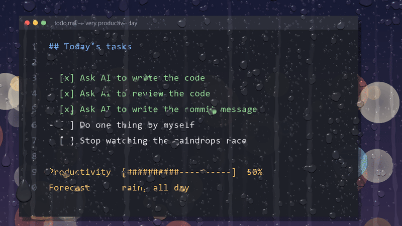

# Anti-Productivity RainyGlass (APRG)

**AIで効率化していく世の中で、あえてあなたの効率を落とします。**



コードは AI が書く。レビューも AI がする。コミットメッセージも AI が考える。
世界はかつてない速さで効率化され、あなたの手元には「浮いた時間」が残りました。

では、その時間で何をしますか？　もっと働く？　いいえ、雨を眺めましょう。

**Anti-Productivity RainyGlass (APRG)** は、あなたのデスクトップを雨の窓ガラスに変えるアプリです。
画面の上を本物そっくりの水滴が伝い、ほかの滴とくっつき、途中で引っかかってはまた滑り落ちていきます。
クリックもキー入力も一切邪魔しないので、仕事は普段どおりできます。……できるはずです。

ただ、気づけばあなたはこう考えています。「左の大きい滴と右の大きい滴、どっちが先に下まで着くだろう」。
その数分こそが、APRG がお届けする唯一にして最大の機能です。

| | |
|---|---|
| 生産性 | 下がります |
| 作業の邪魔 | しません（クリックもキー入力も素通り） |
| 視線の邪魔 | します（それが仕事です） |
| 画面共有・スクリーンショット | 水滴は写りません。会議中に雨を眺めていても、たぶんバレません |
| CPU 負荷 | 1% 未満。下がるのはあなたの効率だけです |

---

**In a world racing to automate everything with AI, APRG proudly makes you less productive.**

AI writes your code, reviews your code, and even writes your commit messages. You have never had so much free time.
So what will you do with it? Work even harder? No. Watch the rain.

APRG turns your Windows desktop into a rain-streaked window. Realistic drops refract whatever is behind them, merge, stall, and suddenly slide down the glass.
It is completely click-through, so you can keep working as usual. In theory.
In practice, you will soon be betting on which drop reaches the bottom first. That is the feature.

- **Productivity:** goes down
- **Your mouse and keyboard:** untouched
- **Your attention:** taken
- **Screen sharing & screenshots:** the rain does not show up, so nobody has to know
- **CPU usage:** under 1 %. The only thing it slows down is you.

## Features / 特徴

- **Click-through** — the overlay never takes focus or intercepts input. / クリック透過・フォーカスを奪わない
- **Real refraction** — each drop acts as a tiny lens and shows an inverted view of what is behind it. / 水滴の中に背後の画面が反転して映る
- **Living rain** — drops grow, merge, stick and slip down the glass, leaving wet trails and tiny droplets behind. / 水滴が合体し、引っかかりながら流れ落ち、流れ跡を残す
- **Multi-monitor** — independent rain on every connected display. / 全モニターに対応
- **Lightweight** — GPU rendering with Direct3D 11; CPU usage is well under 1 %. / GPU 描画で軽量

## Requirements / 動作環境

- Windows 10 version 2004 or later, or Windows 11 (`WDA_EXCLUDEFROMCAPTURE` が必要)
- A GPU that supports Direct3D 11
- [.NET 9 SDK](https://dotnet.microsoft.com/download) (for building) / [.NET 9 Desktop Runtime](https://dotnet.microsoft.com/download/dotnet/9.0) (for running a framework-dependent build)

## Build & run / ビルドと起動

```
dotnet run -c Release
```

The built executable is `APRG.exe`. / 実行ファイル名は `APRG.exe`。

To create a standalone build that does not need .NET installed / .NET 不要の単体版を作る場合:

```
dotnet publish -c Release -r win-x64 --self-contained -p:PublishSingleFile=true -o publish
```

Control it from the tray icon (right-click): pause, toggle rain, rain amount, wipe the glass, exit.
タスクトレイの水滴アイコンを右クリックして操作する（一時停止 / 雨を降らせる / 雨量 / ガラスを拭く / 終了）。

### Command-line options / オプション

| Option | Description |
|---|---|
| `--monitor N` | Show only on monitor N (0-based). Default: all monitors. / 指定したモニターだけに表示 |
| `--no-exclude` | Debug: do not exclude the overlay from screen capture (drops will see themselves and turn white). / デバッグ用 |
| `--snapshot out.png [--bg in.png] [--seconds 6]` | Render offscreen over an image and save a PNG (for tuning the look). / 見た目の調整用に静止画を書き出す |
| `--frames N [--every K] [--intensity X]` | With `--snapshot`: write N numbered PNGs (`{n}` in the output path), advancing K simulation steps (1/60 s each) per frame. Used to make `docs/demo.gif`. / 連番 PNG を書き出す（デモ GIF の作成用） |

## How it works / 仕組み

- **Overlay** — a top-most window with `WS_EX_LAYERED | WS_EX_TRANSPARENT | WS_EX_NOACTIVATE`, drawn through a premultiplied-alpha DirectComposition swap chain.
- **Refraction** — the screen behind the overlay is read with the DXGI Desktop Duplication API. The overlay window excludes itself from capture with `SetWindowDisplayAffinity(WDA_EXCLUDEFROMCAPTURE)` so the drops never refract themselves.
- **Simulation** (`RainSim.cs`) — large drops are simulated on the CPU (stick-slip sliding, merging). Small droplets and wet trails are stamped into a persistent GPU texture and wiped away where sliding drops pass.
- **Shading** (`Shaders.hlsl`) — normals are derived from the combined height map; refraction, dark rims (stronger at the bottom), sky reflection on the top edge and specular highlights are composed into the final image.

The app icon (`Assets/APRG.ico`) is generated by `python tools/make_icon.py` (requires Pillow and NumPy). / アイコンは `tools/make_icon.py` で生成。

Tunables: `Refract`, `BlurLod`, `Darken`, `DecayTrailPerSec` in `Renderer.cs`, and drop density / size in `RainSim.cs`.

## Privacy / プライバシー

APRG reads the screen only to draw the refraction inside the drops. Captured frames stay in GPU memory; they are **never saved to disk or sent anywhere**, and the app makes no network connections.
The only file it writes is `aprg.log` (error messages) next to the executable.

画面の取り込みは水滴内の屈折表示にのみ使い、取り込んだ画像はファイル保存も外部送信もしない。ネットワーク通信は行わない。書き出すファイルは実行ファイルと同じ場所のエラーログ `aprg.log` のみ。

## Notes / 注意

- Because the overlay is excluded from capture, **screenshots and screen recordings will not show the rain**. / スクリーンショットや録画には水滴が写らない
- Plugging in monitors or changing resolution while running is not picked up; restart the app. / 起動中のモニター構成・解像度の変更は再起動で反映
- Exclusive-fullscreen games may draw over the overlay. / 排他フルスクリーンのゲームでは表示されないことがある
- If you have photosensitivity or find moving visuals distracting, use the tray menu to pause at any time. / 動く映像が気になる場合はトレイからいつでも一時停止できる

## License

[MIT](LICENSE) © 2026 DoraNeko. Third-party components are listed in [THIRD-PARTY-NOTICES.md](THIRD-PARTY-NOTICES.md).

This software is provided "as is", without warranty of any kind.
